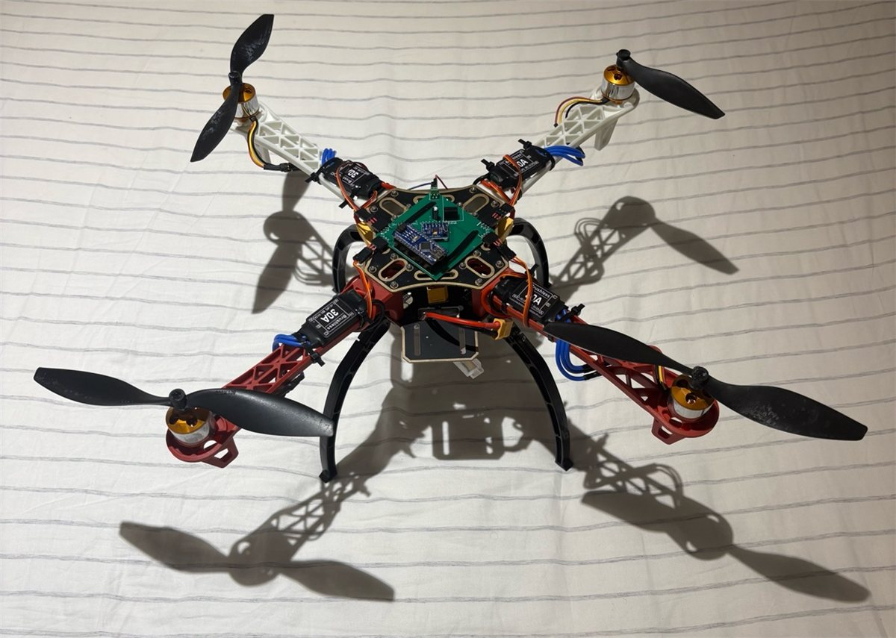
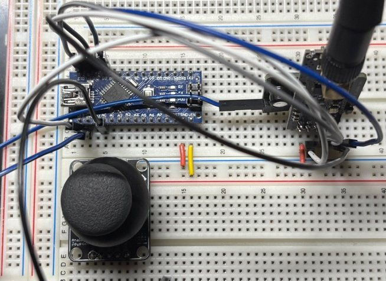
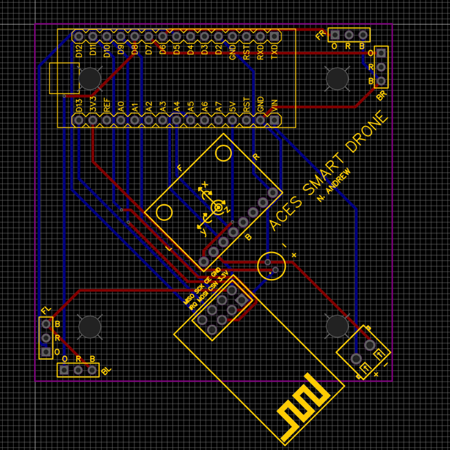
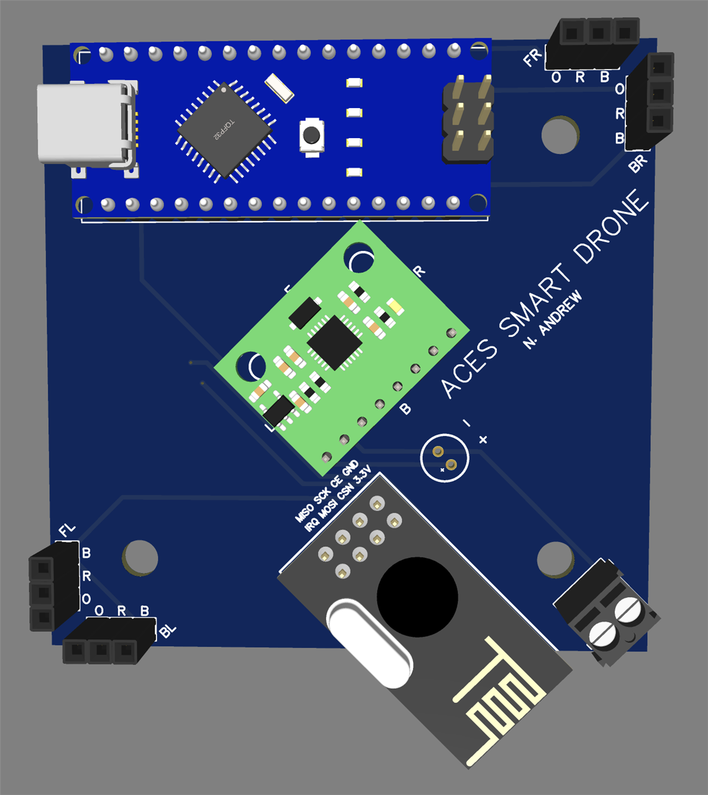
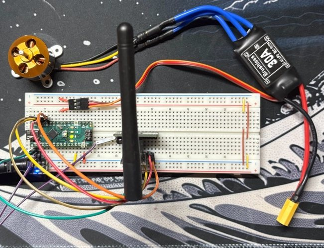

# ACES Smart Drone

A wireless quadcopter throttle-control system: an Arduino Nano **hand controller** reads a joystick and streams throttle values over an nRF24L01 radio link to an **ESC-driven quadcopter**, which spins four brushless motors and cuts power if the signal drops.

<p align="center">
  
</p>


## Overview

A quadcopter holds itself up through balanced thrust and torque: each brushless motor produces lift, an Electronic Speed Controller (ESC) sets its speed from a PWM signal, and neighbouring motors spin in opposite directions to cancel rotational torque. This project builds the control chain that feeds those ESCs.

**Goals**

- Reliable, low-latency communication between controller and drone
- Accurate PWM (1000-2000 us) motor control through four ESCs
- Safe behaviour: ESC arming, a startup spin test, and a signal-loss kill switch

## How it works

| Stage | What happens |
|-------|--------------|
| Joystick read | The vertical axis is sampled on `A0` |
| Dead zone | Readings between 480 and 540 are treated as zero throttle to reject stick noise (values found through bench testing) |
| Mapping | Stick travel above the dead zone is mapped to a 1000-2000 us throttle value |
| Radio | The throttle integer is transmitted on pipe `"00001"` with an nRF24L01 (`RF24` library, low PA level) |
| Receiver | The drone's Nano reads the throttle and writes it to four ESCs (`Servo` library) |
| Safety | If no packet arrives for 300 ms the motors are cut; a manual trim value balances motor output |

## Hardware

**Controller:** Arduino Nano, analog joystick module, nRF24L01 transceiver (CE/CSN on D9/D10).
**Drone:** Arduino Nano, nRF24L01 transceiver, four ESCs on D5 (front left), D6 (front right), D7 (back left) and D8 (back right), four brushless motors on a quad frame.

| Controller breadboard | Controller PCB (EasyEDA layout) |
|:---:|:---:|
|  |  |

| Controller PCB render | ESC and motor bench test |
|:---:|:---:|
|  |  |

## Repository layout

```
aces-smart-drone/
├── firmware/
│   ├── drone_controller/   # Transmitter: joystick -> throttle -> radio
│   └── drone_receiver/     # Receiver: radio -> ESC PWM, arming, kill switch
├── docs/images/            # Build photos, PCB layouts, renders
├── LICENSE
└── README.md
```

## Build and run

1. Install the Arduino IDE and the **RF24** library (Library Manager).
2. Flash `firmware/drone_controller` to the controller Nano and `firmware/drone_receiver` to the drone Nano.
3. Open the serial monitor (9600 baud) on the controller to confirm joystick and throttle values.
4. **Safety:** remove the propellers for all bench testing. The receiver arms the ESCs and runs a ~5 second low-power spin test on boot.

## What I learned

- How ESCs are armed and driven by PWM pulse widths
- Using a dead zone and range mapping to turn a noisy analog input into a stable control signal
- Building failsafes (signal timeout kill switch) into anything that can hurt someone
- Designing a controller PCB in EasyEDA after proving the circuit on a breadboard

## Credits and notes

Built as an ISP (independent study project) in the ACES Computer Engineering course. The code is MIT licensed.
